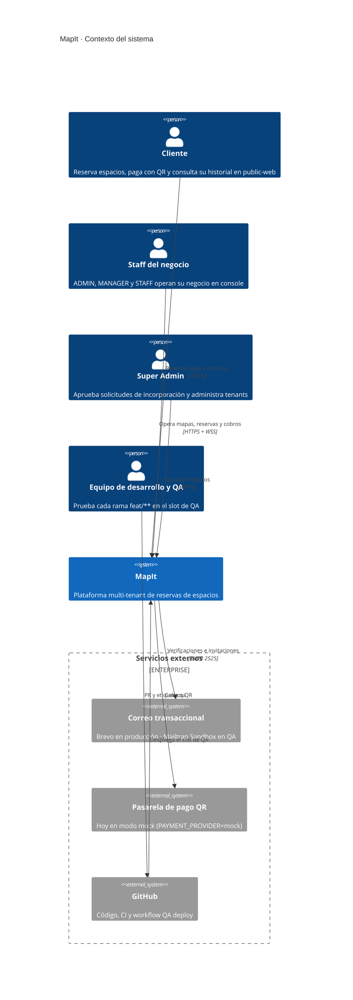
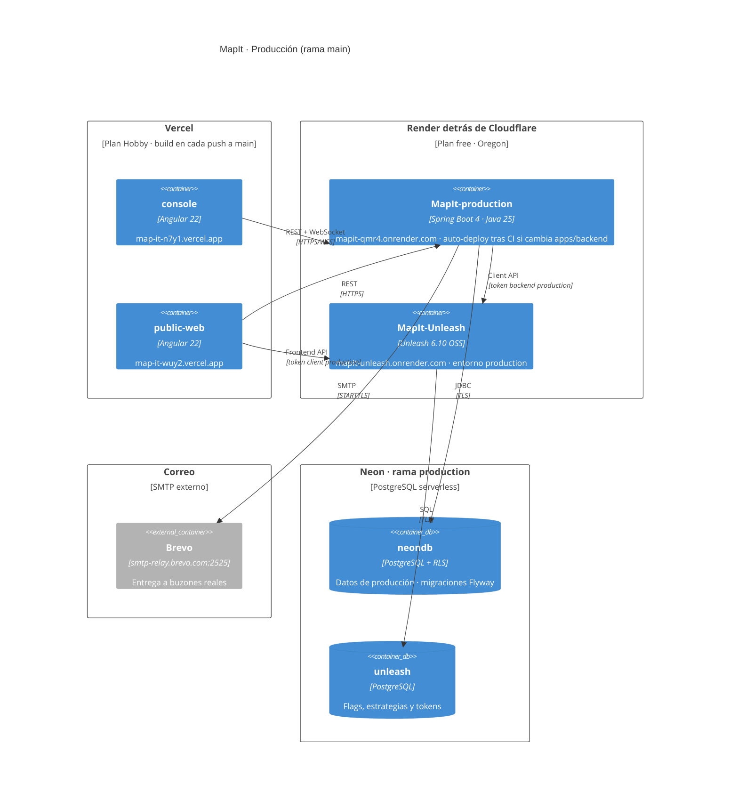
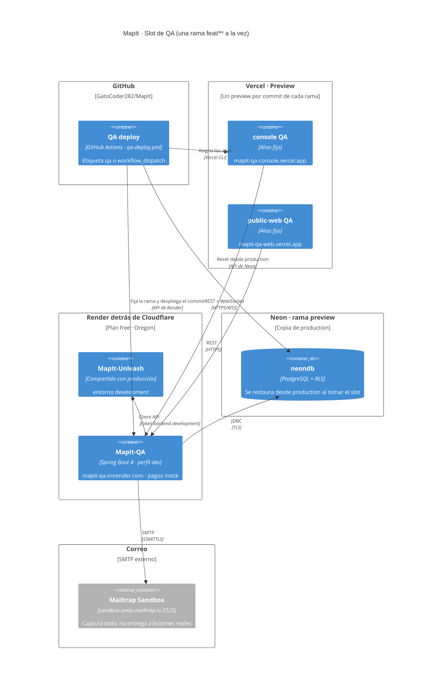

# Infraestructura de MapIt — modelo C4

Tres vistas del [modelo C4](https://c4model.com):

1. **Contexto** (nivel 1): quién usa MapIt y con qué sistemas externos habla.
2. **Despliegue de producción**: dónde corre cada pieza que usan los clientes.
3. **Despliegue del slot de QA**: cómo una rama `feat/**` llega a QA.

GitHub dibuja los diagramas al abrir este archivo. Para editarlos, pega el bloque en
<https://mermaid.live>. Los valores de las variables de entorno están en el [runbook](README.md).

## 1. Contexto

## 2. Despliegue de producción

## 3. Despliegue del slot de QA

### Cómo leerlo

- **Producción y QA comparten el servidor de Unleash**, pero cada uno usa su entorno
  (`production` o `development`) y sus propios tokens. Console y public-web leen los flags desde el
  navegador; en los diagramas se dibuja una sola flecha de frontend para no saturarlos.
- **La base de QA es una copia de producción** (rama `preview` de Neon). `QA deploy` la restaura
  cada vez que una rama toma el slot; un push nuevo a la misma rama redespliega sin restaurarla.
- **Cloudflare** está delante de Render. Por eso el backend lee la IP del cliente de
  `CF-Connecting-IP` (ver [runbook](README.md)).
- **Plan free de Render:** los servicios se duermen tras 15 min sin tráfico y tardan unos 4 min en
  arrancar. El auto-deploy de producción solo corre si el commit toca `apps/backend/**`,
  `infra/docker/backend.Dockerfile` o `.dockerignore` (Build Filters).
