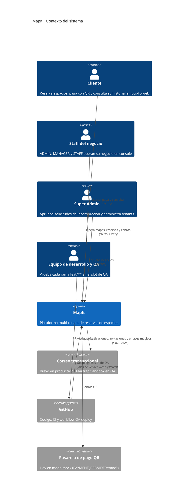
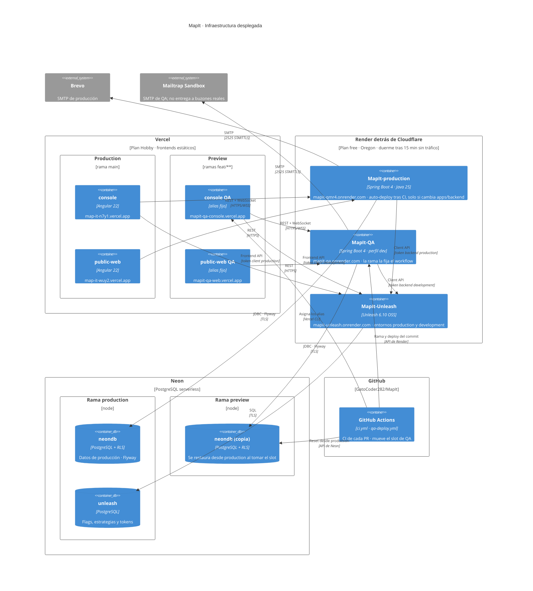

# Infraestructura de MapIt — modelo C4

Dos vistas del [modelo C4](https://c4model.com):

1. **Contexto** (nivel 1): quién usa MapIt y con qué sistemas externos habla.
2. **Despliegue**: dónde corre cada pieza en producción y en el slot de QA.

GitHub dibuja los diagramas al abrir este archivo. Para editarlos, pega el bloque en
<https://mermaid.live>. Los valores de las variables de entorno están en el [runbook](README.md).

## 1. Contexto

## 2. Despliegue (producción y slot de QA)

### Cómo leerlo

- **Producción y QA comparten Unleash**, pero cada uno usa su entorno (`production` o
  `development`) y sus propios tokens. Los dos frontends leen los flags desde el navegador; en el
  diagrama solo se dibujan las flechas de console para no saturarlo.
- **La base de QA es una copia de producción** (rama `preview` de Neon). El workflow `QA deploy` la
  restaura cada vez que una rama toma el slot.
- **Cloudflare** está delante de Render. Por eso el backend lee la IP del cliente de
  `CF-Connecting-IP` (ver [runbook](README.md)).
- **Plan free de Render:** los servicios se duermen tras 15 min sin tráfico y tardan unos 4 min en
  arrancar. El auto-deploy de producción solo corre si el commit toca `apps/backend/**`,
  `infra/docker/backend.Dockerfile` o `.dockerignore` (Build Filters).
