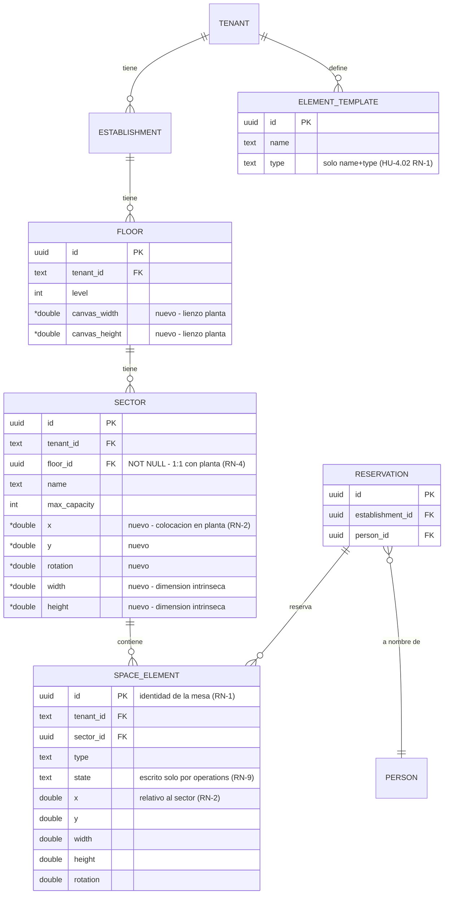

# HU-4.01 — Rediseño del editor de plantas, sectores y elementos reutilizables

> **Estado:** Aprobada · **Creada:** 2026-10-11 · **Aprobada:** 2026-10-11 · **Responsable:** Integrante C (Frontend Editor)
>
> **Jira:** HU-4.01 (épica MAP-88 — E04 Editor Visual de Espacios). Amplía y rediseña lo
> implementado por CU-06 (`/spaces/editor/:sectorId`) y convive con HU-4.02 (plantillas).

## Enunciado

Como **administrador/manager**, quiero **construir y administrar un establecimiento desde la
vista general de la planta hasta el detalle de sus sectores**: editar la geometría de la
planta, ver y colocar sectores dentro de ella como componentes, abrir el diseño interno de
un sector, añadir mesas/barras y otros elementos existentes desde una biblioteca con
drag & drop, y reutilizar un sector ya diseñado sin reconstruirlo — sin crear duplicados
de mesas por el mero hecho de representarlas y sin romper asignaciones, estados operativos
ni reservas existentes.

---

## 1. Por qué (contexto) y diagnóstico del estado actual

El editor actual (CU-06) edita **un solo sector como lienzo plano**: la planta no existe
visualmente y el sector no tiene geometría ni posición dentro de la planta. El asistente
(CU-05) crea pisos y sectores por formulario; el editor los recorre de uno en uno con
selectores de cabecera. Consecuencia: no hay vista del establecimiento completo, la
"ubicación" de un sector no existe en el modelo, y reutilizar un diseño de sector exige
recrear sus elementos a mano cada vez.

### 1.1 Qué existe (verificado en código)

**Backend (módulo `spaces`):**

- Cadena `Tenant → Establishment → Floor → Sector → SpaceElement`, todo con `tenant_id
NOT NULL`, índice `(tenant_id, id)`, RLS y borrado lógico (migraciones V5–V7, V12, V17).
- `Floor`: `id, tenantId, establishmentId, name, level, slug`. **Sin geometría** — un piso
  es hoy solo una etiqueta ordenada (`Floor.java`).
- `Sector`: `id, tenantId, floorId (NOT NULL), name, slug, maxCapacity`. **Sin geometría,
  sin dimensiones, sin posición**. La limitación está documentada en el propio dominio
  (`SpaceElement.java` javadoc: "RN-6: el modelo de sector no tiene dimensiones todavía").
- `SpaceElement`: `id, tenantId, sectorId, type, state, x, y, width, height, rotation`.
  Coordenadas **relativas a la esquina superior izquierda del sector**; CHECKs `x,y ≥ 0`,
  `w,h ≥ 20`. 7 tipos (`TABLE, BAR, SECTOR_ZONE, STAGE, SEAT, ROOM, DECOR`) con política
  por vertical (`SpaceElementTypePolicy`). El `state` operativo lo gestionan `operations`
  (PATCH + auditoría + STOMP), no el editor.
- `ElementTemplate` (HU-4.02): solo `{name, type}` — deliberadamente sin geometría ni
  enlace con instancias (RN-1/RN-5 de esa spec).
- Reservas: `reservation.spaceElementIds` vía tabla `reservation_space_element` con FKs
  compuestas `(tenant_id, …)` que hacen estructuralmente imposible una asignación
  cross-tenant. `CreateReservation` valida elemento vivo, activo, reservable y sin
  solapamiento; identidad de mesa = `space_element.id` (UUID generado por el servidor).
- Contrato (`packages/api-contract/openapi.yaml`): CRUD por recurso
  (`/establishments`, `/floors`, `/sectors`, `/sectors/{id}/elements`,
  `/element-templates`). **Sin** lectura agregada de planta, **sin** guardado por lotes,
  **sin** DELETE de elemento (el dominio tiene `softDelete()` pero no está expuesto).

**Frontend (`apps/console`, feature `map-editor`):**

- Editor de **un sector**: `MapEditorStore` + `MapEnginePort` (adaptador Konva en
  `libs/map-engine`), con drag/rotar/redimensionar, clamping, persistencia con debounce
  por elemento (`PUT /sectors/{sectorId}/elements/{elementId}`) y rollback ante error.
- Paleta lateral de plantillas (HU-4.02) con "guardar como plantilla" y aplicar por clic
  (crea instancia en `x=100, y=100`); no hay drag & drop real paleta→canvas.
- Navegación: `/spaces/editor/:sectorId` + queryParams (`sectorName`, `floorId`,
  `establishmentId`); entradas desde el resumen del asistente (`wizard-summary.ts`) y
  selectores piso/sector del editor. Flag `map-editor.enabled` en el catálogo tipado.
- `MapLayout` (modelo propio, ADR-0006): `{floorId, name, size, elements, schemaVersion}`
  — lista plana de elementos; no modela sectores anidados.

### 1.2 Qué falta (huecos para esta HU)

1. **La planta no tiene geometría**: no existe un canvas de planta donde dibujar el
   contorno ni un espacio donde colocar sectores.
2. **El sector no tiene geometría ni colocación**: imposible posicionarlo/dibujarlo en la
   planta. El tamaño del lienzo del sector es una **constante de frontend**
   (`DEFAULT_SECTOR_SIZE = 1200×800`, duplicada en `map-editor-store.ts` y en
   `konva-map-engine.ts`), desconectada del dominio.
3. **No existe reutilización de sectores**: ni plantilla de sector, ni duplicado, ni
   colocación por referencia.
4. **Lectura N+1 por diseño**: montar una vista de planta exige GET floors → GET sectors →
   GET elements por sector; no hay endpoint agregado.
5. **Persistencia de canvas = PUT por elemento**: sin transacción de conjunto; dos
   editores se pisan mutuamente (last-write-wins, sin detección de conflicto).
6. **`SpaceElement` sin identificador de negocio**: sin etiqueta/número de mesa; el
   frontend fabrica `label` como `TYPE + id.slice(0,6)`.
7. **Defaults duplicados**: `TYPE_DEFAULTS` (tamaño/capacidad por tipo) existe dos veces
   en frontend y no existe en el dominio.
8. **Conflicto con edición concurrente/realtime**: HU-3.02 publica cambios de **estado**
   vía STOMP, pero los cambios de **geometría** no se difunden (la spec HU-3.02 lo dejó
   explícitamente fuera: "publicar movimientos exigiría un diff/merge").

### 1.3 Contradicciones detectadas (no esconderlas)

| #   | Contradicción                                                                                                                                                                                                                            | Impacto                                                                                                                | Tratamiento                                                                                                |
| --- | ---------------------------------------------------------------------------------------------------------------------------------------------------------------------------------------------------------------------------------------- | ---------------------------------------------------------------------------------------------------------------------- | ---------------------------------------------------------------------------------------------------------- |
| C-1 | La spec CU-06 §6 RN-3 afirma que "el backend no persiste rotación ni size hoy". **Ya es falso**: V12 creó `width/height/rotation` y el PUT los acepta y persiste.                                                                        | Documentación desactualizada que puede inducir a un agente a "añadir" campos existentes.                               | Corregir RN-3 de CU-06 en el commit de esta HU (nota en `tasks.md`).                                       |
| C-2 | El enunciado pide "colocar dos veces el mismo sector" (múltiples instancias enlazadas), pero el modelo actual es `sector.floor_id NOT NULL` (un sector pertenece a UNA planta) y las mesas son recursos de reserva con identidad propia. | Dos arquitecturas incompatibles: definición-compartida (sincronización viva) vs. copia explícita (identidades nuevas). | Resuelto en §6/D-1: **copia explícita con UUIDs nuevos**; justificación en RN-5.                           |
| C-3 | El clamping actual usa un tamaño de sector inexistente en BD (constante 1200×800): la validación de límites superiores de coordenadas es ficticia.                                                                                       | Validaciones de geometría dependen de datos que no existen.                                                            | Se resuelve al dar dimensiones reales al sector (§6 RN-10, plan §5).                                       |
| C-4 | La "biblioteca de sectores" del flujo 3 supone sectores "disponibles" para colocar, pero hoy un sector sin colocación no es representable y un sector de otra planta pertenece a esa planta.                                             | La UX de la biblioteca depende de D-1.                                                                                 | Biblioteca = sectores del establecimiento **duplicables** + sectores de la planta aún sin colocar (§4 F3). |

---

## 2. Actores

| Rol                     | Qué hace en este caso de uso                                                                               |
| ----------------------- | ---------------------------------------------------------------------------------------------------------- |
| Administrador / Manager | Edita la planta (geometría), coloca/transforma sectores, diseña sectores, usa plantillas, duplica sectores |
| Staff                   | Mismo acceso técnico hoy; la restricción fina por rol es de CU-24                                          |
| Cliente final           | Fuera de alcance: no toca la consola (public-web no se modifica)                                           |

## 3. Precondiciones

- Sesión JWT con claim `tenant` (el tenant nunca viene de URL ni body en rutas de staff).
- Existe un establecimiento con al menos un piso (CU-04/CU-05 completados).
- HU-2.03 (elementos espaciales) y HU-4.02 (plantillas de elemento) implementadas.
- `MapEnginePort` con adaptador Konva funcional (ADR-0006 sigue _Propuesto_; el motor de
  facto es Konva — ver riesgo R-1 del plan).

## 4. Flujo principal

### F1 — Construir una planta (vista de planta)

1. El usuario abre una planta desde el listado de pisos del establecimiento →
   ruta nueva `/spaces/floors/:floorId/editor` (vista de planta).
2. El canvas muestra la geometría de la planta y, dentro, cada sector del piso con su
   contorno y una **representación en solo-lectura de sus elementos** (misma fila
   `space_element`, renderizada dentro del marco del sector).
3. El usuario edita la forma/límites de la planta (dimensiones del lienzo; Fase 1 =
   rectángulo — ver D-2).
4. Abre la **biblioteca de sectores**: sectores del establecimiento (de otras plantas)
   que puede duplicar aquí, y sectores de esta planta aún sin colocar.
5. Arrastra un sector desde la biblioteca (o un sector sin colocar) hasta la planta y lo
   suelta dentro de sus límites → se crea (duplicado, F3) o se posiciona (colocación).
6. Desplaza/rota el sector dentro de la planta; el clamping impide salirse del lienzo.
7. Guarda → `PUT /floors/{floorId}/layout` transaccional (geometría de planta +
   colocaciones de sectores en un solo guardado).
8. Al seleccionar un sector y pulsar "editar sector" → navega a `/spaces/editor/:sectorId`
   (vista de sector existente).

### F2 — Diseñar un sector (vista de sector, evoluciona la actual)

1. El usuario selecciona un sector en la planta (o entra por el flujo existente).
2. El editor de sector muestra su geometría real (dimensiones persistidas, ya no la
   constante 1200×800) y todos sus elementos.
3. Añade mesas/barras/etc. **arrastrando plantillas** de la biblioteca al canvas
   (drag & drop paleta→canvas; hoy solo existía aplicar-por-clic).
4. Mueve/rota/redimensiona elementos con los comandos existentes.
5. Guarda la distribución → guardado por lotes del sector
   (`PUT /sectors/{sectorId}/layout`), transaccional.
6. Vuelve a la planta → el sector se re-renderiza con su composición actualizada (misma
   fila leída por ambas vistas: no hay nada que "sincronizar").
7. Puede también eliminar un elemento (DELETE nuevo) y guardar la forma/dimensiones del
   propio sector.

### F3 — Reutilizar un sector

1. El usuario, en la vista de planta, abre la biblioteca de sectores.
2. Elige un sector del establecimiento (típicamente de otra planta) y lo arrastra a esta
   planta.
3. El sistema **duplica**: crea un sector nuevo (nombre derivado + slug nuevo) en esta
   planta y **clona sus elementos con UUIDs nuevos**, copiando geometría interna.
   No existe enlace vivo origen→copia tras el duplicado (ver RN-5 y D-1).
4. La representación muestra la geometría interna clonada; el usuario la coloca/transforma.
5. Editar el original no afecta a la copia, y viceversa (son recursos físicos distintos).
6. Intentar "colocar dos veces" el mismo sector no es una operación del modelo: el mismo
   sector ya está en su planta; lo que se repite es el **diseño**, vía duplicado.

### F4 — Reutilizar elementos (plantillas)

1. En la vista de sector, el usuario arrastra una plantilla de la biblioteca al canvas.
2. El drop crea una **instancia nueva** de `SpaceElement` en el punto de caída, con el
   `type` de la plantilla y su geometría por defecto (D-5: defaults en el dominio).
3. La instancia es un recurso válido para asignaciones/reservas/estados desde su creación
   (mismos endpoints y reglas existentes).
4. Modificar o borrar la plantilla **no altera** las instancias ya existentes (regla
   HU-4.02 RN-5, se conserva).

## 5. Flujos alternativos y errores

| Situación                                                  | Comportamiento esperado                                                                                    |
| ---------------------------------------------------------- | ---------------------------------------------------------------------------------------------------------- |
| Planta sin sectores                                        | Estado vacío con CTA a la biblioteca de sectores y al alta de sector                                       |
| Drop de plantilla fuera del lienzo del sector              | No se crea nada; feedback visual de zona válida                                                            |
| Coordenada negativa o fuera de límites (elemento o sector) | El frontend clampea; el backend valida (`x,y ≥ 0`, límites superiores contra las dimensiones reales) → 400 |
| Guardado por lotes con versión base obsoleta               | 409 Problem Details con la lista de recursos en conflicto; el frontend ofrece recargar y reaplicar         |
| Fallo parcial en el guardado por lotes                     | Imposible por diseño: una transacción; en error, rollback y la vista no queda a medias                     |
| Duplicar un sector de otro tenant                          | 404 indistinguible (aislamiento; test obligatorio)                                                         |
| Elemento borrado por otro usuario mientras se edita        | 404 en el guardado → toast y refresco de la vista                                                          |
| Recarga (F5)                                               | Las dos vistas rehidratan desde la API; nada de valor vive solo en memoria                                 |
| Recurso visual sin persistencia                            | Solo zoom/pan, selección y estado de diálogo; todo lo demás persiste o se descarta explícitamente          |

## 6. Reglas de negocio

**RN-1 (Identidad inviolable de la mesa).** Una mesa es `space_element.id` (UUID). Ninguna
operación de renderizado, duplicado de vista o cambio de contexto regenera ni aliasa esa
identidad. Las reservas (`reservation_space_element`) y la bitácora
(`space_element_state_change`) se anclan a ella.

**RN-2 (Sistemas de coordenadas separados).** Las coordenadas de un elemento son relativas
a la esquina superior izquierda **de su sector**; la colocación de un sector es relativa a
la esquina superior izquierda **de su planta**. Mover/rotar un sector en la planta **nunca**
modifica los `x,y` de sus elementos, y editar un elemento dentro del sector **nunca**
modifica la colocación del sector. La representación del sector dentro de la planta es una
**transformación de render** (traslación+rotación), no una copia de datos.

**RN-3 (Fuente de verdad única por fila).** La vista de planta y la vista de sector leen y
escriben **las mismas filas** (`floor`, `sector`, `space_element`). No existe ninguna copia
JSON enlazada que requiera sincronización: lo que en el enunciado se llama "coherencia
sector↔planta" se logra porque ambas vistas son lentes sobre el mismo dato, no por un
motor de propagación.

**RN-4 (Colocación 1:1).** Un sector pertenece a exactamente una planta
(`sector.floor_id NOT NULL`, invariante actual que se conserva). "Colocar" = fijar su
geometría de colocación dentro de su planta. Un sector no se "coloca dos veces": ver D-1.

**RN-5 (Reutilización = copia explícita).** La reutilización de un diseño de sector es una
operación de **duplicado** visible para el usuario: nuevo sector + clones de sus elementos
con **UUIDs nuevos**. Razón de negocio: las mesas son recursos físicos de reserva; dos
mesas en dos plantas tienen reservas y estados propios, por lo que compartir `id` entre
plantas rompería reservas, disponibilidad y bitácora. Tras el duplicado no hay enlace
vivo: editar el original no toca la copia (y viceversa).

**RN-6 (Política de edición por contexto — tabla campo a campo).**

| Campo                                             | Fuente de verdad                     | Lo escribe                     | Efecto en la otra vista                                                      |
| ------------------------------------------------- | ------------------------------------ | ------------------------------ | ---------------------------------------------------------------------------- |
| Forma/dimensiones del lienzo de la planta         | `floor` (columnas nuevas)            | Vista de planta                | La vista de sector no la consume                                             |
| Dimensiones intrínsecas del sector                | `sector` (columnas nuevas)           | Vista de sector                | La planta re-renderiza el contorno del sector                                |
| Colocación del sector en la planta (x, y, rot.)   | `sector` (columnas nuevas)           | Vista de planta                | La vista de sector no la consume (RN-2)                                      |
| Posición/tamaño/rotación de un elemento           | `space_element`                      | Vista de sector                | La planta lo refleja al recargar: misma fila, sin copia                      |
| Propiedades compartidas de una mesa vía plantilla | `element_template`                   | Gestor de plantillas (HU-4.02) | Las instancias ya creadas **no cambian** (sin enlace vivo)                   |
| Identidad de una mesa vinculada a reservas        | `space_element.id`                   | Nadie, tras el alta            | —                                                                            |
| Asignaciones/datos operativos (estado, bitácora)  | `space_element.state` + `operations` | Módulo `operations` (PATCH)    | El editor nunca los escribe; el editor tampoco escribe geometría en el PATCH |

**RN-7 (Concurrencia).** Los guardados por lotes llevan control optimista: el payload
incluye el `updatedAt` observado de cada recurso y el servidor rechaza con 409 (Problem
Details, lista de conflictos) si alguna fila cambió debajo. El PUT individual de elemento
mantiene el comportamiento actual (debounce + rollback) como fallback de edición fina.

**RN-8 (Multi-tenant).** Sin cambios: tenant del JWT, filtrado explícito + RLS, "ajeno"
y "no existe" indistinguibles. El duplicado no puede cruzar tenants (C-2 de §1.3 no
aplica: el sector fuente se resuelve dentro del tenant).

**RN-9 (Separación de responsabilidades de escritura).** Editar geometría nunca toca
`state`; cambiar `state` nunca toca geometría. El editor de plantas/sectores y el módulo de
operaciones siguen siendo escritores disjuntos de la misma fila.

**RN-10 (Restricciones espaciales).** Elemento dentro de su sector (0 ≤ x,y; límites
superiores contra las dimensiones reales del sector, ya no contra la constante); sector
dentro de su planta. Validación doble: clamp en el cliente, regla en el application
backend (el dominio no conoce la planta del sector desde el propio sector, así que la
validación de límites vive en el caso de uso, igual que `FloorService` hace hoy).

**RN-11 (Persistencia como estructura de datos).** Todo el layout se persiste como datos
relacionales/numéricos (RF05/CU-08): jamás como imagen ni como blob de un proveedor.

## 7. Criterios de aceptación

- [x] **CA-1** — _verificado en implementación (evidencia en tasks.md)_: Dado un establecimiento con un piso y sectores con elementos, cuando abro
      `/spaces/floors/:floorId/editor`, entonces veo el lienzo de la planta con cada sector
      colocado en su posición y sus elementos renderizados en solo-lectura dentro del marco
      del sector — sin hacer N+1 requests manuales (un solo `GET /floors/{id}/layout`).
- [x] **CA-2** — _verificado en implementación (evidencia en tasks.md)_: Dado un sector con elementos, cuando muevo el sector dentro de la planta y
      guardo, entonces persiste su colocación (`sector.x/y/rotation`) y los `x,y` **de sus
      elementos no cambian** (test de integración lo verifica fila a fila).
- [ ] **CA-3:** Dado un sector visible en la planta, cuando lo selecciono y pulso
      "editar sector", entonces navego a `/spaces/editor/:sectorId` y el editor muestra el
      mismo conjunto de elementos con los mismos ids (sin duplicados) y las dimensiones
      reales del sector persistidas.
- [ ] **CA-4:** Dado un elemento añadido a un sector (desde plantilla con drag & drop),
      cuando la planta se re-renderiza, entonces ese elemento aparece dentro del sector **una
      sola vez** y con el mismo `id` que creó el alta (no hay copia por representación).
- [x] **CA-5** — _verificado en implementación (evidencia en tasks.md)_: Dado el tenant A con un sector con elementos, cuando duplico ese sector
      hacia una planta del tenant A, entonces obtengo un sector nuevo con elementos nuevos
      (UUIDs distintos, misma geometría interna) y el original queda intacto.
- [x] **CA-6** — _verificado en implementación (evidencia en tasks.md)_: Dado un sector del tenant B, cuando el tenant A intenta duplicarlo por id,
      entonces recibe 404 y no se crea nada (test de aislamiento obligatorio).
- [ ] **CA-7:** Dado el editor de sector, cuando cambio dimensiones del sector y guardo,
      entonces un elemento fuera de los nuevos límites es reportado (400/409 con detalle) en
      lugar de quedar silenciosamente fuera del lienzo.
- [x] **CA-8** — _verificado en implementación (evidencia en tasks.md)_: Dado un guardado por lotes cuya versión base quedó obsoleta por otra
      edición, cuando lo envío, entonces recibo 409 con la lista de recursos en conflicto y la
      vista ofrece recargar sin perder mi trabajo en curso.
- [ ] **CA-9:** Dado un elemento con reserva activa, cuando muevo/roto ese elemento en el
      editor y guardo, entonces la reserva sigue anclada al mismo `space_element.id`
      (verificable en integración: la fila de `reservation_space_element` no cambia).
- [ ] **CA-10:** Dado el editor, cuando cambio la geometría de un elemento, entonces
      `space_element.state` no se modifica (y viceversa con el PATCH de `operations`).
- [x] **CA-11** — _verificado en implementación (evidencia en tasks.md)_: Dado un drop de plantilla sobre el canvas del sector, cuando suelto
      dentro del lienzo, entonces se crea un elemento nuevo en las coordenadas del drop; si
      suelto fuera, no se crea nada.
- [ ] **CA-12:** Dado cualquier flujo de esta HU, cuando recargo (F5), entonces todo lo
      construido persiste (los estados puramente visuales —zoom, pan, selección— pueden
      perderse).
- [ ] **CA-13:** Dados dos tenants con establecimientos, cuando cualquiera de los dos usa
      el editor completo (planta, sector, duplicado), entonces nunca ve ni modifica datos del
      otro (RLS + test de integración bidireccional).
- [x] **CA-14** — _verificado en implementación (evidencia en tasks.md)_: Dado el conjunto de la HU, cuando corre `pnpm check`, entonces queda en
      verde (incluye ArchUnit, api:check y Vitest de los stores nuevos/actualizados).

## 8. Fuera de alcance

- **Polígono libre** para la forma de la planta: Fase 1 es lienzo rectangular (D-2);
  el polígono se evalúa después con su propia spec.
- **Edición inline de elementos desde la vista de planta** (D-3): solo colocación de
  sectores; la edición interna se hace en la vista de sector.
- **Instancias enlazadas en vivo** de un mismo diseño de sector (D-1, resuelto como no).
- **Propagación en tiempo real de la edición** entre editores concurrentes (la HU-3.02
  ya la excluyó; aquí solo se detecta el conflicto con 409).
- Undo/redo, multi-selección, agrupamiento (CU-06 los dejó fuera; se reevalúa aparte).
- Etiqueta/número de negocio para mesas y plantillas con geometría/capacidad rica
  (D-4/D-5 del plan; hoy `ElementTemplate` sigue siendo `{name, type}`).
- SSR/public-web, autorización fina por rol (CU-24), cambio de motor de canvas (ADR-0006).

## 9. Impacto multi-tenant

- **Sin tablas nuevas.** Solo columnas nuevas en `floor` y `sector` (geometría), que
  heredan RLS y `tenant_id` existentes. Conforme a la política del repo, no requiere
  migración de aislamiento nueva, pero **sí** tests: el endpoint de duplicado y el
  agregado de layout son superficies nuevas que se prueban con tests de aislamiento
  bidireccionales (CA-6, CA-13) con Testcontainers.
- El tenant nunca viaja en URL ni body en las rutas de staff (se conserva).
- Nota de seguridad existente y transitoria: el CRUD de spaces está hoy `permitAll()` con
  fallback a tenant demo, pendiente de CU-23/24; los endpoints nuevos siguen esa política
  provisional y quedan en el inventario para el endurecimiento de CU-24.

## 10. Requerimientos relacionados

RF04/RF05 (mapa como estructura de datos) · CU-05 (pisos y sectores) · CU-06 (editor
visual; esta HU lo rediseña) · CU-07/HU-4.02 (plantillas) · CU-08 (persistencia como
datos) · HU-2.03 (elementos espaciales) · HU-3.01/HU-3.02 (estados y realtime: mismos
recursos, escritores disjuntos) · ADR-0006 (motor de mapa tras puerto).

## 11. Modelo de dominio (propuesto; lo actual verificado está en §1.1)

> Cambios propuestos marcados con `*`. Todo lo demás ya existe y se verifica en el código.

## 12. Arquitectura del canvas (un motor, dos contextos de edición)

Se mantiene **un único motor** (`MapEnginePort` + adaptador Konva) con **dos contextos de
edición** — no se duplica renderer, store de selección ni gestión de drag & drop:

| Contexto         | Lienzo                       | Nodos editables                                            | Nodos en solo-lectura           | Guardado                           |
| ---------------- | ---------------------------- | ---------------------------------------------------------- | ------------------------------- | ---------------------------------- |
| **Vista planta** | Geometría de `floor`         | Contorno del lienzo; sectores (mover/rotar/colocar)        | Elementos dentro de cada sector | `PUT /floors/{id}/layout` (lotes)  |
| **Vista sector** | Contorno del `sector`        | Elementos (mover/rotar/redimensionar); contorno del sector | —                               | `PUT /sectors/{id}/layout` (lotes) |
| **Biblioteca**   | Panel HTML aparte del canvas | Origen de drag & drop (plantillas; sectores duplicables)   | —                               | Solo lectura                       |

- **Selección sector→edición:** en la vista de planta el sector es un nodo compuesto; al
  seleccionarlo aparecen su marco y una acción "editar sector" → navegación a la vista de
  sector con retorno a la planta (query param de retorno).
- **Extensión del modelo propio:** `MapLayout` (nuestro, no del proveedor) se extiende con
  un discriminador de contexto (`kind: 'floor' | 'sector'`) y una lista de
  `SectorPlacement` para el modo planta. El adaptador Konva ya usa `Konva.Group` para
  elementos; el sector en modo planta es un grupo anclado (traslación+rotación de grupo =
  transformación de render, RN-2).
- **Sin lógica de negocio en el canvas:** la UI dispara comandos del ViewModel; el
  api-client es la única vía HTTP. La biblioteca es HTML (accesible) y el drop se
  resuelve a coordenadas del lienzo en el componente de página.

## 13. Decisiones abiertas (registro y recomendación explícita)

| #   | Decisión                                                                                                                          | Recomendación                                                                                                                                                                                                                                                                                    | Estado                                                                                                                               |
| --- | --------------------------------------------------------------------------------------------------------------------------------- | ------------------------------------------------------------------------------------------------------------------------------------------------------------------------------------------------------------------------------------------------------------------------------------------------ | ------------------------------------------------------------------------------------------------------------------------------------ |
| D-1 | ¿El negocio quiere instancias enlazadas en vivo de un mismo diseño de sector (propagación automática de ediciones entre plantas)? | **No.** Reutilizar = duplicado explícito con UUIDs nuevos (RN-5): la identidad de mesa-existente exige recursos físicos distintos y el enlace vivo genera conflictos de merge sin contrapartida de negocio clara. Si el hotel (CU-22) exige "plantas idénticas enlazadas", se especifica aparte. | **Decidida (2026-10-11): copia explícita.**                                                                                          |
| D-2 | ¿Geometría de planta: rectángulo o polígono libre?                                                                                | **Rectángulo en Fase 1** (dimensiones del lienzo); polígono requiere validación de contención de sectores rotados — complejidad que no aporta hoy.                                                                                                                                               | **Decidida (2026-10-11): rectángulo en Fase 1.**                                                                                     |
| D-3 | ¿Editar elementos desde la vista de planta?                                                                                       | **No en Fase 1**: solo colocación de sectores; la edición interna vive en la vista de sector (intención ambigua, valor bajo). Si se permite después, escribirá la misma fila (RN-3) y no requiere sincronización.                                                                                | **Decidida (2026-10-11): solo colocación en la vista de planta.**                                                                    |
| D-4 | ¿Añadir `label`/número de negocio a `space_element`?                                                                              | **Sí, pero en spec posterior** (toca contrato+BD+UX y es transversal a reservas). Aquí se documenta el hueco.                                                                                                                                                                                    | Abierta                                                                                                                              |
| D-5 | ¿Mover los `TYPE_DEFAULTS` (tamaño/capacidad por tipo) al dominio/backend?                                                        | **Sí** (fase de contrato): elimina la doble constante del frontend y da coherencia al alta vía plantilla. La capacidad reservable sigue siendo solo visual en esta HU.                                                                                                                           | Propuesta                                                                                                                            |
| D-6 | ¿Nueva flag para la vista de planta?                                                                                              | **Sí**: `map-editor.floor` (release, puesta a punto progresiva), conviviendo con `map-editor.enabled`.                                                                                                                                                                                           | **Revertida (2026-10-12): sin flag.** La página era nueva sin riesgo operativo; la flag costó más de lo que protegía (ver tasks.md). |
